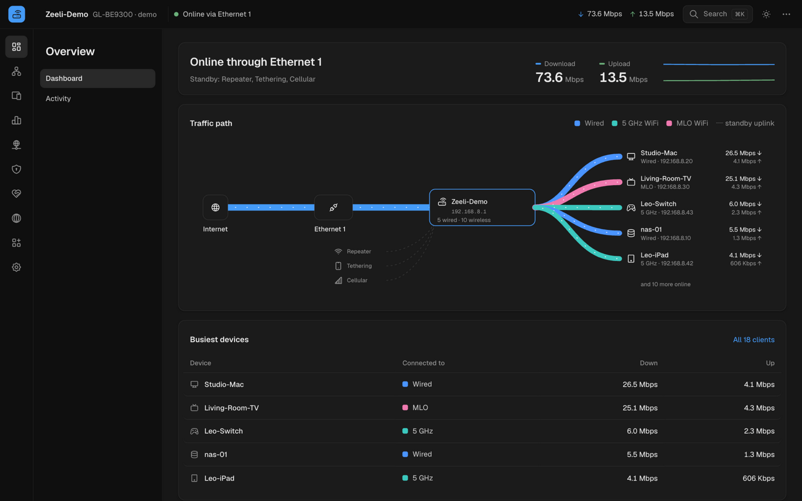
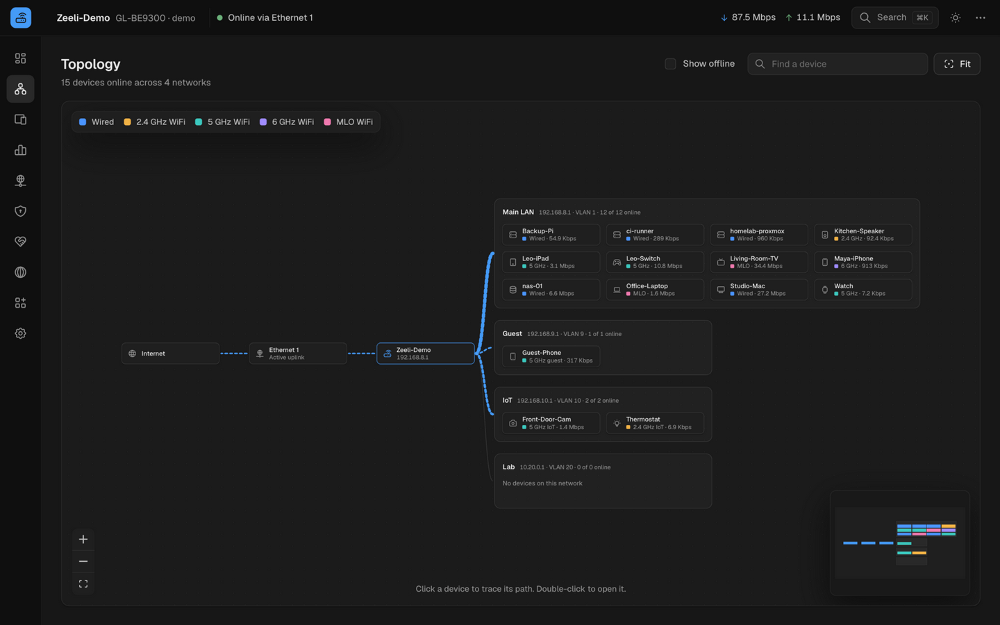
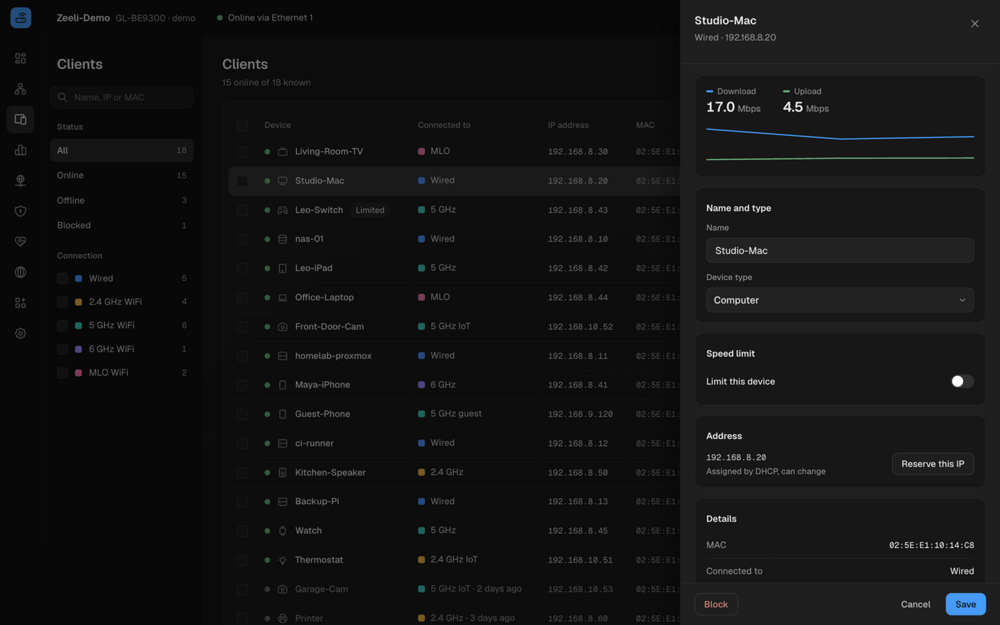
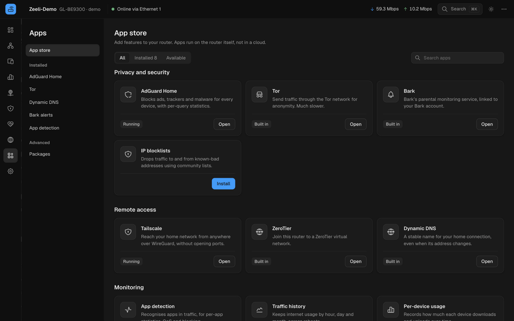

# Zeeli Controller

An open-source web console for OpenWrt routers, in the spirit of UniFi Network: one place to see what the network is doing and change it.

Zeeli Controller runs on GL.iNet firmware today and is tested on a GL-BE9300 (Flint 3). A Zeeli image built on OpenWrt is planned.

## Why

Most people already own a capable router. What they lack is a console they can trust: one that is fast and clear, and that tells them the truth about whether a change worked. Zeeli Controller is that console. It talks only to the router on your network. It has no vendor cloud, no account and no telemetry. When you save a setting, the console reads it back from the router and reports success only if the router kept the value.

## Screenshots

All screenshots come from the demo router (`pnpm dev:demo`).









## Features

The console's pages map onto these sections. The full list lives in [`apps/console/src/app/nav.ts`](apps/console/src/app/nav.ts).
- **Overview**: a dashboard with live uplink state and per-device rates, plus an activity timeline.
- **Topology**: a zoomable map of the path from the internet, through the router, to each device.
- **Clients**: every device on the network. Rename, block, forget or rate-limit them.
- **Insights**: traffic by device and app, and DNS queries from AdGuard Home.
- **Network**: internet (WAN, repeater, PPPoE, static), WiFi, networks and VLANs, Ethernet ports, DHCP and leases, routing, multi-WAN, mesh, QoS, SQM, IPv6, IGMP snooping, NAT acceleration, EdgeRouter.
- **Security**: firewall rules, port forwarding, DNS and filtering (encrypted DNS, rebinding protection), content filter, access control, remote management.
- **Family**: parental control with schedules and pause.
- **VPN**: tunnels with policy routing, WireGuard and OpenVPN client profiles, WireGuard and OpenVPN servers, Tailscale, ZeroTier.
- **Apps**: an app store for built-in and OpenWrt package apps, with settings pages for AdGuard Home, Tor, dynamic DNS, Bark alerts and app detection, plus raw package management.
- **System**: device health, firmware, schedules, time zone, logs, admin access, operating mode, factory reset.

A command palette (Cmd+K or Ctrl+K) finds any page. Light and dark themes are both supported.

## Quick start

You need Node 24 (see [`.nvmrc`](.nvmrc)) and pnpm 11.

```sh
pnpm install
```

### Try the demo

```sh
pnpm dev:demo
```

Open http://localhost:4318. The demo runs an in-memory router in your browser with a seeded home network. Every page works, and writes change the demo state. The password is `demo`.

### Run against a real router

```sh
pnpm dev
```

The dev server proxies `/rpc`, `/cgi-bin`, `/upload`, `/download` and `/control` to the router, so the console behaves as if it were served from the router itself. Sign in with the router's admin password.

| Variable     | Default               | Purpose                                                                                                                                                                                                                              |
| ------------ | --------------------- | ------------------------------------------------------------------------------------------------------------------------------------------------------------------------------------------------------------------------------------ |
| `ROUTER_URL` | `https://192.168.8.1` | The router the dev proxy forwards API calls to. The router's self-signed certificate is accepted.                                                                                                                                    |
| `VERIFY_SSH` | unset                 | When set, the dev server answers the console's reads by running them on the router over SSH with your key, and refuses every write. Useful for checking pages against live data without signing in. Dev only, never part of a build. |
| `ROUTER_SSH` | `root@192.168.8.1`    | The SSH target used when `VERIFY_SSH` is set.                                                                                                                                                                                        |

```sh
ROUTER_URL=https://192.168.1.1 pnpm dev
VERIFY_SSH=1 ROUTER_SSH=root@192.168.1.1 pnpm dev
```

### Build

```sh
pnpm build
```

The console builds to `apps/console/dist` as a static bundle with relative paths, so it can be served from a subpath on the router.

### Install on your router

```sh
ROUTER_SSH=root@192.168.8.1 pnpm deploy:router
```

This builds the console and copies it to `/www/zeeli` on the router over SSH (key access required), then prints the address: `https://192.168.8.1/zeeli/`. GL.iNet's own panel, LuCI and SSH keep working beside it. Sign in with the router's admin password; the session is shared with the stock panel.

It also installs one permission file, [`tools/router/zeeli-controller.acl.json`](tools/router/zeeli-controller.acl.json), which lets the admin session see whether services are running and start or stop them, start a one-test iperf3 server, and send Wake on LAN packets. Nothing else. To remove everything:

```sh
ssh root@192.168.8.1 'rm -rf /www/zeeli /usr/share/rpcd/acl.d/zeeli-controller.json && /etc/init.d/rpcd reload'
```

A firmware upgrade that doesn't keep settings removes the folder; run the command again afterwards.

## Architecture

```
apps/console          React interface: pages, components, queries
   |
packages/router-api   Typed domain API: clients, wifi, networks, vpn, ...
   |
Transport             gl   (GL.iNet: /rpc, LuCI ubus, AdGuard Home, file upload/download)
                      mock (in-memory router for the demo and tests)
```

- The console never builds a request itself. It calls the domain API, for example `api.clients.list()` or `api.dns.config.set(...)`, and renders the result through TanStack Query.
- `router-api` turns raw firmware answers into typed domain objects and raises one error type, `RouterError`, with messages written for people.
- A `Transport` is the only seam to the router. The GL.iNet transport and the mock implement the same interface, and a plain-OpenWrt transport will too, so screens do not change.
- Writes are verified. Firmware often answers "ok" to a value it silently ignores, so a success response alone is not trusted. `writeAndVerify` writes, reads the setting back, and throws a `notKept` error if the value did not stick. Settings pages use `settings()` get/set pairs, which do this for every value they send. One-shot actions (rename, forget, reboot) refetch the data they touch, so the screen always shows what the router reports.

[`docs/ARCHITECTURE.md`](docs/ARCHITECTURE.md) covers the code layout in depth and explains how to add a page or an app.

## Quality gates

```sh
pnpm check
```

This runs every gate in order. CI runs the same gates on every push and pull request.

| Command          | What it checks                                  |
| ---------------- | ----------------------------------------------- |
| `pnpm lint`      | Biome lint and formatting                       |
| `pnpm typecheck` | TypeScript across all packages                  |
| `pnpm test`      | Vitest unit tests                               |
| `pnpm doctor`    | react-doctor checks on the console              |
| `pnpm fallow`    | Unused code, duplication and dependency hygiene |
| `pnpm build`     | Production build                                |

## Roadmap

- A plain-OpenWrt transport, so the console runs on stock OpenWrt as well as GL.iNet firmware.
- A Zeeli firmware image built on OpenWrt, with the console as its interface.
- Screenshots and a hosted demo.

## Contributing

See [CONTRIBUTING.md](CONTRIBUTING.md). To report a security issue, follow [SECURITY.md](SECURITY.md) instead of opening a public issue.

## License

[Apache-2.0](LICENSE).
